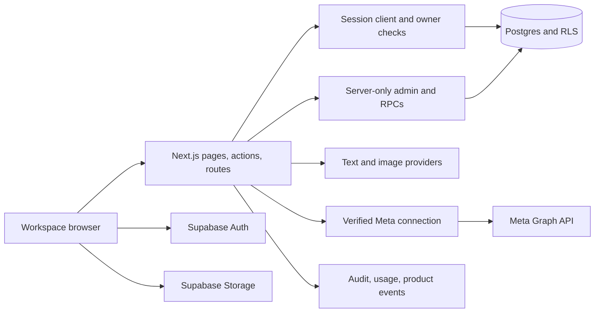
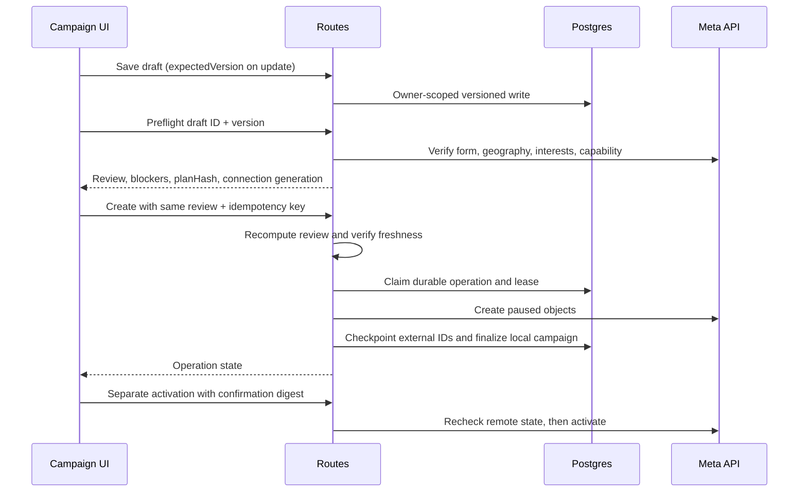

# Architecture

Use this guide to locate the owner of a request, diagnose interrupted work, or
change a workflow without bypassing its authorization and persistence checks.
[API Reference](api/README.md) owns wire contracts, [Data Model](DATA_MODEL.md)
owns tables/migrations, and [Features](product/README.md) owns the customer workflow.

### Source and Release Scope

Reviewed against development commit `672eb132ad57bb3ba31f118afaffddaa878b4923`
on September 26, 2026. The SDK/query release (PR #36)
recorded production commit `6291dc2d2691bfc8a235b2aa1b103f119b26b83e`.
These are deliberately different baselines:

| Layer | What this guide can establish |
| --- | --- |
| Released SDK/query integration | AI SDK adapters and the scoped TanStack campaign-list hook shipped in PR #36; the receipt describes the bounded deployed checks |
| Current development source | Includes DB integrity/trusted-write changes and test-payment work excluded from that release; source presence does not establish applied production migrations |
| Enquiry candidates | [#34 / PR #37](https://github.com/vanshulgoyal101/adbrain/pull/37) adds resumable import; [#35 / PR #38](https://github.com/vanshulgoyal101/adbrain/pull/38) adds saved follow-up/listing. Neither is part of this baseline or the cited production release |

Use [Meta Connection](architecture/channels/meta-connect.md#lead-import-and-follow-up) for the candidate
boundary and concrete migration handoff. Documentation is not deployment approval.

## System Overview



The browser is untrusted. RLS protects tenant queries; admin operations require
explicit owner checks and constrained RPCs. Not all writes pass through API
routes: brand assets and other browser Supabase interactions rely on Storage/DB
policies. Route instrumentation therefore is not a complete mutation ledger.

## Repository Map

| Location | Responsibility |
| --- | --- |
| [app](../src/app/) | Public pages, authenticated `(app)` pages, auth completion, API handlers |
| [components](../src/components/) | Interactive workspace and shared UI primitives |
| [proxy](../src/proxy.ts) | Session refresh/request guard entry point; sends signed-in owners from the static homepage to `/dashboard` (#1376) |
| [Supabase](../src/lib/supabase/) | Session/admin clients, query ownership and aggregation |
| [creative](../src/lib/creative/) | Interview, guarded generation, design, raster persistence, receipts |
| [LLM](../src/lib/llm/) | Application facade owns routing/key cooldown/cache/accounting; AI SDK adapters own text transport and schema output |
| [image generation](../src/lib/imageGen/) | Provider adapters and bounded raster validation |
| [campaign](../src/lib/campaign/) | Drafts, planner, preflight, operations, targeting, activation, spend, reports |
| [Meta](../src/lib/meta/) | OAuth, encrypted tokens, discovery, capability checks, verified provider access |
| [Meta UI client](../src/lib/meta-connect-ui/) | Typed transport, query-owned campaign display reads, preparation cancellation and browser recovery; not mutation authority |
| [security](../src/lib/security/) | Outbound network policy, shared limits, headers |
| [observability](../src/lib/observability/) | Request context, structured events, post-response persistence |
| [database](../db/) | Fresh schema and incremental migrations |
| [tests](../tests/), [e2e](../e2e/) | Unit/component contracts and browser scenarios |
| [scripts](../scripts/) | Local verification and explicitly guarded operational tools |

Next.js 16 differs from earlier framework versions: read the installed
`node_modules/next/dist/docs/` guidance before changing routing, proxy, or async
request APIs. Route parameters are promises in this codebase. Do not replace
current patterns with older framework recipes without checking them.

## Identity and Tenant Ownership

1. Supabase Auth provides the session; server handlers verify `getUser()` rather
  than treating browser IDs or cached page data as authorization.
2. [Queries](../src/lib/supabase/queries.ts) resolve the primary owned workspace.
  Session-scoped queries still require DB/Storage policies; hidden UI is no policy.
3. [Connection access](../src/lib/meta/connection-access.ts) authenticates ownership
  and issues an opaque branded `AuthorizedBusiness` context. A caller cannot gain
  provider authority by constructing a plain business-ID object.
4. `withMetaConnection` checks authorization, purpose capability, optional expected
  generation/binding, then rereads the token binding before decrypting credentials.
  Pause/delete require the campaign's original binding and generation; they do not
  need an activation capability, but still need management permission.
  A **managed** business (2-Tier child under AdBrain's parent business, #518) has a
  `managed_meta_accounts` row instead (#519). With `MANAGED_ACCOUNTS_ENABLED`, its calls use
  that row's child ad account and Page with the child's own system-user token (`manager_token_id`,
  read with `meta_token_get` for that business only, #624), through the same generation, binding and
  capability checks. A missing, revoked, expired or unreadable child token fails closed
  (`UNAVAILABLE`, no Meta call); it never falls back to the parent token
  (`META_PARENT_SYSTEM_TOKEN`, provisioning and re-mint only) or an OAuth connection. Reads, pause and delete work whenever the ad account
  and Page exist (any state, so spend can always be stopped); paused creation needs `state =
  ready`, and activation also needs `funding_state` `card_attached` or `invoiced` and a current
  Meta spending limit with room on the child account (`managedSpendCapGate`, #522). The ledger's ad
  account can't change once set, so its generation is 1 unless the ledger adds one; a Page change
  is caught by campaign bindings. A contract test pins these columns and values to #519's
  migration. Businesses without a managed row stay on their OAuth connection
  ([managed-account.ts](../src/lib/meta/managed-account.ts), #525).
5. Admin clients bypass RLS. Each trusted-write/RPC boundary must therefore enforce
  its own actor, tenant and concurrency conditions. Development DB-A callers depend
  on their corresponding migration grants/functions being installed.

The development identity fallback is intentionally separate from real API auth.
Global Meta environment credentials do not authorize a customer's publishing
action. A business ID supplied by a client is never proof of ownership.

## Creative Data Flow

Brand + active instructions + goal/history -> bounded interview -> editable
brief -> per-angle concept/copy and image generation -> raster/design persistence
-> draft creative rows -> explicit approval.

The [text facade](../src/lib/llm/index.ts) keeps provider selection, key rotation,
cache policy and usage accounting outside the SDK. The
[SDK adapter](../src/lib/llm/providers/sdk.ts) performs one physical text attempt
with SDK retries disabled. Image generation remains a separate adapter boundary;
installing a text SDK does not route raster generation through it.

Each saved variant is independent. `variant_group` connects a client-known UUID
to recoverable rows. [Studio](../src/components/studio.tsx) persists that identity
before POST and reconciles GET results before offering a fresh attempt. Late
responses may clear only their matching pending identity. This is recovery of
saved results, not a durable generation queue, cross-tab admission lock, or
once-only paid execution guarantee. Regeneration resets approval. See
[AI Pipeline](AI_PIPELINE.md#variant-generation) for partial results and costs.

## Campaign Data Flow



Three independent concurrency values matter:

| Value | Guards against |
| --- | --- |
| Draft `version` | Another tab editing saved inputs |
| Connection `generation` | Assets/token authorization changing during work |
| Review `planHash` | Targeting resolution, creative content, selected assets, or budget changing since review |

The creation `idempotencyKey` identifies the same intended operation. It cannot
be reused for different inputs. Database claim/checkpoint/finish RPCs arbitrate
competing workers. A transmitted/uncertain Meta write becomes
`needs_reconciliation`, not an automatic replay. External-ID checkpoints are
important even when a local campaign row has not been finalized. One exception
(#735): if a create fails after Meta made the campaign but before any ad set, the
client deletes that empty PAUSED campaign (sync can't import a campaign without ad
sets); when Meta confirms, the operation is `failed` with nothing left in Meta, and
when the delete fails it stays `needs_reconciliation`.

Activation has its own digest and live verification; creation permission never
implies permission to spend. Budget checks use the total daily commitment across
ad sets. Targeting failures block rather than silently broaden the audience.

## Consistency Boundaries

### Campaign Execution and Read Models

Campaign creation orchestration lives in
[create-service](../src/lib/campaign/create-service.ts), independent of HTTP.
The create route authenticates and verifies the reviewed request; the operation
repository owns claims/checkpoints; the Meta adapter owns provider payloads.
In opt-in worker mode, the route enqueues and returns 202. The standalone worker
rechecks current ownership, draft version, review hash and connection generation
before calling the same service. No Meta creation step is moved to a browser task
or an unawaited Vercel promise. All creation remains PAUSED.

The existing `campaign_operations` ledger is also the queue. Service-only RPCs
claim pending rows with `FOR UPDATE SKIP LOCKED`; expired running jobs require
reconciliation rather than automatic mutation replay. See
[Operations](operations/runbooks/campaigns.md#campaign-worker-rollout) for leases and deployment.
Inline execution remains the default compatibility mode until that rollout.

Campaign display reads use stable `(created_at,id)` cursors, owner-scoped filters,
and at most 50 rows. Reports/spend checks use complete keyset reads and fail on
any page error; they do not reuse the display page. Complete reads still scale
linearly and are not a transactionally consistent financial ledger. The dashboard
is a server component and still computes its queue from complete campaign data.

Destination is explicit on campaigns and result snapshots: `instant_form`,
`whatsapp`, `call`, `mixed`, or `unknown`. Unavailable conversation metrics are
not zero leads; mixed/unknown/call outcomes are excluded from lead comparisons.
Legacy fallbacks use saved creation evidence, conversation metrics, or the old
app-specific `leads` objective, not arbitrary Meta engagement objectives.

### Campaign List Cache

[useCampaignList](../src/lib/meta-connect-ui/use-campaign-list.ts) owns display
reads through TanStack Query, not campaign mutations. Each mounted view creates
its own `QueryClient`, seeded from server-provided rows; there is no global
cross-owner SSR cache. Keys contain owner, business, trimmed search and status.
Those keys isolate presentation state; the list route still authorizes every read.

- The query function passes its `AbortSignal` to fetch and checks it after JSON
  parsing. Old exact keys are removed on scope/filter changes; unmount clears the
  client. Pages deduplicate by campaign ID and merge stored result snapshots.
- Browser back/forward replays a page's earlier server render (#1003). The page
  stamps each render with a `renderId`; a view that mounts with an id this tab
  already showed refetches its list once, so a pause or edit made since shows.
- Nonempty search settles after 250 ms; changing status settles the current search
  immediately. Freshness is 30 seconds and cache GC is 60 seconds. Retries,
  mount/focus/reconnect refetch and polling are disabled explicitly.
- Append reads require another cursor and no current fetch. Explicit reload
  cancels the active key, reduces cached pages to the first page, then refetches.
- Mutation-result setters cancel stale reads, patch cached display data, and
  invalidate the owner/business scope. The existing mutation handlers retain their
  confirmation, ownership, provider and persistence responsibilities.

Do not reuse this bounded display cache for complete spend/report calculations.
[Preparation](../src/lib/meta-connect-ui/use-campaign-preparation.ts) and
[targeting conversion](../src/lib/campaign/editor-targeting.ts) remain separate
owners. This is not an application-wide query or editor state-machine rewrite.

| Boundary | Failure mode | Recovery principle |
| --- | --- | --- |
| Browser -> generation | HTTP ends after some paid work | GET by generation ID before new POST |
| Browser -> draft | Stale version | Reload/merge intentionally; do not overwrite |
| App -> Meta creation | Response lost after provider mutation | Query operation; reconcile external IDs |
| Meta -> local campaign mirror | Provider succeeded, DB failed | Verify remote state, preserve evidence |
| Storage -> database | File uploaded but row save failed | Best-effort cleanup; no distributed transaction |
| Usage/event sink | Persistence unavailable | Preserve business result; report health; never rerun paid work merely to log it |
| Candidate #34 lead import | Later provider page or checkpoint fails | Keep committed pages; resume recorded cursor with owner/binding and version checks |

Not every endpoint uses one response envelope or one status mapping. New connection,
draft, preflight, and operation APIs use typed envelopes; older routes retain
plain JSON or download responses. Clients must use the actual contract.

## Security and Resource Bounds

Outbound URL handling rejects unsafe addresses and revalidates redirects, with
DNS-bound connection handling to reduce rebinding risk. Remote media has byte,
pixel, format, frame, and time limits before use. The compositor receives validated
inline rasters rather than arbitrary remote URLs. RLS is still necessary even
when UI controls hide actions.

Paid routes use an atomic shared database rate limiter. Production fails closed
if enforcement is unavailable; nonproduction can fall back to process memory.
Monthly usage is a separate non-atomic quota preflight. Neither mechanism is a
provider billing limit. See [Operations](operations/README.md).

Meta tokens live encrypted in a private schema and are accessed through server-only
RPCs. Browser DTOs contain selected assets/capabilities, never tokens. OAuth uses
signed state, browser binding, expiry, replay protection, and selection revisions.
These controls protect the app boundary; they do not prove Meta has approved the
app or granted usable access to a particular customer's assets.

## Background and Observability

Vercel invokes authenticated daily keepalive and spend-enforcement routes. These
are bounded HTTP jobs, not a persistent worker fleet. UI polling and post-response
`after` tasks do not constitute durable queues.

The opt-in [campaign worker](../scripts/campaign-worker.ts) is a separate persistent
process, not a Vercel cron route. Its source is present; durable hosting, health
checks and alert ownership must be established before enabling it. Do not start
it merely to validate these docs: it can execute real campaign operations.

Owner audit history, trusted AI usage, and structured product events are separate
stores. Product telemetry uses request-local async context and safe metadata;
database logging is opt-in after migration and best effort. See
[Observability](operations/observability.md) for exact limits and privacy. Logs are evidence
for diagnosis, not proof that every side effect was durably recorded.

## Where to Make Changes

- A new campaign input generally touches the draft schema, planner conversion,
  UI persistence, preflight hash, execution adapter, and regression tests.
- A new provider belongs behind the existing text/image interfaces; document
  credentials, reference support, deadlines, cost reporting, and fallback behavior.
- A new table needs explicit privileges/RLS, fresh-schema and upgrade parity,
  typed rows, and disposable database tests.
- A new route needs ownership, runtime input validation, resource limits,
  response-contract documentation, telemetry privacy review, and failure tests.
- A changed user workflow needs loading, empty, partial, failure, retry, and
  ambiguous-result behavior, not only the successful path.

Keep deployment policy in [Release Workflow](RELEASING.md). Do not infer that all
uncommitted work in a shared checkout is ready to publish together.

For verification, start with [connection access tests](../tests/meta-connection-access.test.ts),
[Studio recovery tests](../tests/studio.test.tsx), and the owning module's existing
suite; [Testing](team/testing.md) owns execution commands and environment isolation.

## Multi-Channel Architecture (ADR-001, #1792)

**Status:** proposed (CTO, Oct 29). The Reviewer's eight conditions are incorporated below;
the CEO's approval is still required before Phase 1 starts.

### Context

AdBrain will add Google, TikTok, X and other ad channels. Today Meta reaches almost everywhere:
121 files outside `src/lib/meta` import it (53 in `src/app`, 51 in `src/lib`, 17 components, 14 scripts),
`src/lib/campaign` (68 files) speaks in ad sets and Meta statuses, and the database keys campaigns, ads,
results and leads on `meta_*` ids. A second channel today would mean copying the launch, manage, results
and leads paths. Nothing enforces module boundaries in CI (ESLint has no import rules).

### Decision

1. **Channel-neutral domain.** Business, Brand, Creative, MediaAsset (owner uploads and consents, #744), Campaign
   (goal, budget, cap, schedule, audience intent), Lead, Result and Connection are plain types and rules with no I/O and no channel words.
2. **One adapter per channel** behind `ChannelAdapter`. Meta is adapter #1. A channel's object tree (Meta's
   campaign → ad set → ad), ids, statuses and error codes stay inside its adapter; the domain holds only
   opaque `ExternalRef`s.
3. **Services orchestrate** (launch, manage, results, leads, connect). They read and write the database and
   call adapters only through the registry. Routes and components call services, never channels.
4. **Boundaries are enforced in CI** with a baseline that can only shrink (Phase 1).
5. **The data model grows additively:** `channel` plus external identity columns. Nothing is dropped or
   renamed (#1173); Meta columns stay until no code reads them.
6. **Strangler migration, not a rewrite:** each slice moves one path behind the adapter with behaviour
   unchanged, proven by the existing recorded core tests.

### Folder layout

| Folder | Holds | May import |
| --- | --- | --- |
| `src/domain/` | Types and pure rules (`campaign.ts`, `results.ts`, `leads.ts`, `channel.ts` with the adapter interface) | Nothing app-specific (zod, std only) |
| `src/channels/<name>/` | Adapter, transport, mapping to and from domain types, channel-only stores (e.g. `meta/tokens`, `meta/managed`) | `domain`, `lib/security`, `lib/observability`, `lib/supabase` for the channel's **own private tables only** (tokens, attempts); never `public.*` business tables, which go through services and RLS |
| `src/channels/registry.ts` | `adapterFor(channel)`, the only place that names concrete adapters | `channels/*` |
| `src/services/` | Orchestration with DB access: `launch`, `manage`, `results`, `leads`, `connect` | `domain`, `channels/registry`, `lib/*` |
| `src/app/`, `src/components/` | Routes and UI (unchanged locations; components split by feature in Phase 4) | `services`, `domain`, `lib/*`; **never** `channels/*` |
| `src/lib/` | Shared infrastructure (supabase, llm, imageGen, security, observability, payments). Loose files move into domain folders as they're touched | as today |

Existing code moves only when its slice is migrated: `src/lib/meta` → `src/channels/meta`, the Meta-shaped
parts of `src/lib/campaign` → `channels/meta`, the channel-neutral parts → `domain` or `services`.

### The adapter interface (sketch)

```ts
// src/domain/channel.ts
export type Channel = "meta" | "google" | "tiktok" | "x";
export type ExternalRef = { channel: Channel; kind: string; id: string }; // opaque outside the adapter

export interface CapMechanism {                  // how a channel can bound total spend (#2048)
  kind: "campaign_cap" | "lifetime_budget" | "total_budget";
  guarantee: "native" | "service_enforced";      // native: the provider stops delivery; else our watchdog does
  minMinor: Record<string, number>;              // per currency, e.g. Meta campaign_cap ≥ ₹5,000
  requiresEndTime: boolean;
}

export interface ChannelCapabilities {
  objectives: ("enquiries" | "chats" | "calls" | "traffic")[];
  formats: ("image_4x5" | "image_1x1" | "story_9x16" | "video")[];
  leadForms: boolean; messaging: boolean;
  capMechanisms: CapMechanism[];                 // empty → the service refuses activation
  audienceEditInPlace: boolean; // false → edits need a copy-and-switch (Meta today)
  minDailyBudgetMinor: Record<string, number>; // per currency
}

export interface ChannelContext {               // reads
  businessId: string; connection: ConnectionBinding; signal?: AbortSignal;
}
export interface WriteContext extends ChannelContext { // every write method takes this; the registry refuses one without
  connection: ConnectionBinding & { generation: number; account: string }; // bound account + generation, required
  idempotencyKey: string;                              // persisted by the service *before* the call
  writeMode: "full" | "pause_only";
}

export type WriteOutcome<T> =
  | { status: "done"; value: T }
  | { status: "uncertain"; refs: ExternalRef[] }; // → needs_reconciliation, never auto-replayed

export interface ResultSnapshot {                // #2050; the card renders this with no channel branch
  ref: ExternalRef; period: Period; timezone: string; currency: string;
  dateBasis: "interaction" | "conversion" | "reported";
  spendMinor: number; impressions: number;
  clicks: number; clickKind: "link" | "all";   // Meta link clicks, Google all clicks
  results: { value: number; resultType: string }[]; // value may be fractional (Google conversions)
  unsupported: { field: string; reason: string }[]; // unsupported is never 0
  complete: boolean;                             // false → missing rows are not zeros
}

export interface ChannelAdapter {
  readonly channel: Channel;
  capabilities(ctx: ChannelContext): Promise<ChannelCapabilities>;
  connect: ConnectFlow;                                   // OAuth/discovery/selection; channel-specific steps behind one flow
  validate(ctx: ChannelContext, plan: LaunchPlan): Promise<Validation>; // dry run only
  launch(ctx: WriteContext, plan: LaunchPlan): Promise<WriteOutcome<LaunchedCampaign>>; // always paused
  activate(ctx: WriteContext, ref: ExternalRef, cap: SpendCap): Promise<WriteOutcome<void>>;
  pause(ctx: WriteContext, ref: ExternalRef, scope?: "campaign" | "ad"): Promise<WriteOutcome<void>>;
  editBudget(ctx: WriteContext, ref: ExternalRef, budget: Budget): Promise<WriteOutcome<void>>;
  editAudience(ctx: WriteContext, ref: ExternalRef, audience: AudienceIntent): Promise<WriteOutcome<AudienceEdit>>;
  editCreative(ctx: WriteContext, ref: ExternalRef, creative: CreativeVersion): Promise<WriteOutcome<void>>;
  syncStatus(ctx: ChannelContext, refs: ExternalRef[]): Promise<CampaignState[]>;
  fetchResults(ctx: ChannelContext, ref: ExternalRef, period: Period): Promise<ResultSnapshot>;
  syncLeads(ctx: ChannelContext, cursor?: string): Promise<LeadPage>;
  enforceSpendCap(ctx: WriteContext, ref: ExternalRef, cap: SpendCap): Promise<WriteOutcome<void>>;
  cleanup(ctx: WriteContext, refs: ExternalRef[]): Promise<WriteOutcome<void>>;
  revoke(ctx: WriteContext): Promise<void>; // best effort, never blocks disconnect (#1649)
}
```

Every write method above takes a `WriteContext` (the `ctx` of `launch`, `activate`, `pause`, `editBudget`,
`editAudience`, `editCreative`, `enforceSpendCap`, `cleanup`, `revoke`).

**Contracts every adapter must pass** (a shared contract test suite, Meta's recorded tapes first):
- **Capped activation:** `validate` picks one `capMechanism` for the plan's amount (Meta today: `campaign_cap`,
  native, from ₹5,000; below that `lifetime_budget`, service-enforced; Google `total_budget`, native, only once a
  `validate_only` create succeeds for that campaign type and bid strategy). `activate` writes the cap, **reads it
  back** (cap, end time, no uncapped daily budget), and only then turns delivery on; any other path returns
  `uncertain`. A `service_enforced` mechanism activates only once `enforceSpendCap` is scheduled for the ref.
  **There is never a fallback to a daily or uncapped budget:** if no mechanism validates, the service refuses
  activation, never substitutes.
- **Idempotency:** neither provider honours an idempotency key, so the service guarantees it. The key is
  persisted before transport, with one in-flight write per key and connection generation. A transport-ambiguous
  create returns `uncertain`; reconciliation looks for an object carrying the key's marker. Exactly one match is
  adopted; zero or several stay `uncertain` and are never re-created automatically (zero matches does not prove
  the create failed).
- **Partial failure:** Google launch objects go in one `GoogleAdsService.Mutate` with `partial_failure=false`
  (all or nothing). Meta has no transaction: every `launch` step is PAUSED and `cleanup` removes partial trees.
- **Schedules** are in the provider account's timezone, stored with the ref. UI duration minimums are not
  validation rules; the `validate_only` call decides.
- **Results:** `result_type` comes only from an explicit per-action mapping in the adapter (raw Google
  `conversions` stays `google_conversion` until a mapped action says otherwise). Money converts to minor units
  inside the adapter (Google `cost_micros` via the ISO 4217 exponent, aggregated before one documented rounding).
- **Generation:** a write whose generation no longer matches the stored connection is refused before transport.
- **Disconnect:** `revoke` revokes the grant at the provider (best effort); the service then purges the
  credential (deleted, not only marked revoked: #1648, #1734).

**Tenancy:** the business always comes from the service's context, never from channel data. `syncLeads` and
`fetchResults` return external refs; the service maps each ref to a business through its **own** stored refs
and drops anything unmatched (#1775's bug: one Page's leads landing in every business bound to it).

**Inbound callbacks** (deauthorize, data deletion, webhooks) live in `src/app/api/<channel>/…`, verify the
channel's signature on the raw body **before** parsing, then hand verified data to a service.

**Errors:** adapters throw `ChannelError { code: "auth" | "rate_limited" | "policy" | "not_found" |
"invalid" | "transient" | "uncertain", retryable, channelCode }`. Plain owner words come from the domain
(the #1690 rejection copy becomes a per-channel map), never from provider text (#451).

**Fit check (Meta today → method):** every public `MetaClient` method and the Graph helpers in `oauth.ts`,
`capability-verification.ts`, `parent.ts` and `managed-provision-runner.ts` map to a method above. Lead
forms → `syncLeads` and `validate`; geo and interest resolution → `validate` and `editAudience`;
`switchAdSet`, `createCappedAdSet` and `deleteAdSetCopy` → inside `editAudience`/`activate`/`cleanup`;
`setAccountSpendCap` and `enforceCampaignSpendCap` → `enforceSpendCap`; WhatsApp number discovery and
managed provisioning → `connect` (Meta-only steps). Nothing needs a Meta word in the interface.
Owner media (#744): the library and consents are core; uploading to a channel (`adimages`/`advideos`) and its
spec checks happen inside `validate`/`launch`, driven by `capabilities.formats`.

### Data plan (Phase 3, DevOps)

| Change | Tables | Notes |
| --- | --- | --- |
| Add `channel text not null default 'meta'` | `campaigns`, `campaign_ads`, `campaign_results`, `ad_results`, `leads`, `lead_sync_runs`, `campaign_edit_operations`, `private.customer_ad_reservations`, `private.customer_ad_costs` | Default backfills every row in one statement |
| Add `external_id`, `external_status` | `campaigns`, `campaign_ads`, `ad_results`, `leads` | Backfill from `meta_campaign_id`, `meta_ad_id`, `effective_status`, `meta_lead_id` |
| New uniques beside the old ones | `(business_id, channel, external_id)` on campaigns and leads; `(campaign_id, channel, external_id, period)` on ad_results | Old Meta uniques stay until their columns are unread |
| Normalised result columns | `campaign_results`, `ad_results` | `results` **numeric** (Google conversions are fractional), `result_type`, `cost_per_result`, `clicks` + `click_kind` (`link` for Meta, `all` for Google), money in minor units |
| New `channel_connections` | `(business_id, channel)` primary key, `external_account_id`, `status`, `generation`, `capabilities` | Backfilled from `meta_connections`, which becomes Meta-private |
| Credentials stay per channel | `private.meta_tokens` stays; each new channel gets its own private token table | Credential shapes differ; one generic table would hide risk |

`channel_connections.generation` carries the **same counter** Meta writes check today (backfilled from
`meta_connections.generation`, never reset), so in-flight operations can't pass a stale check. The new
uniques and `channel_connections` ship with RLS (owner select via `owns_business`, service-only writes) and
metadb tests in the same migration.

All RPCs keep their names. New RPCs are channel-neutral (`channel_connection_status`). RLS and the metadb
tests cover every new column and table before release.

### Phases and owners

| Phase | Slices (small PRs, behaviour unchanged, `test:core` green) | Owner |
| --- | --- | --- |
| **1. Guardrails** | dependency-cruiser in CI with a generated baseline that can only shrink; rules: components and routes never import `channels/*` or `lib/meta`; `domain` imports no I/O; only `channels/meta` builds Graph URLs. File-size budget: new files ≤ 400 lines, existing big files listed and may only shrink. `knip` dead-code check (#1786). | CTO |
| **2. Meta behind the adapter** | In risk order, reads first, money writes last: (a) results + status sync, Dev 4; (b) leads + WhatsApp, Dev 2; (c) connect/OAuth/managed, Dev; (d) launch/validate/activate, Dev 3; (e) manage: pause, budget, audience switch, creative, Dev 2. Each slice also splits its part of `meta/client.ts` (2,436 lines) and `types.ts`. Slices (d) and (e) touch money and Meta writes: Reviewer + QA verdicts. | Devs; the Reviewer reviews every slice |
| **3. Channel-neutral data** | The migrations above, then reads switch to the new columns | DevOps + Dev 4 |
| **4. UI by feature** | Split `campaigns.tsx` (2,729), `ad-assistant.tsx`, `studio.tsx`, `lead-inbox.tsx` into feature folders; a channel badge and capability-driven options | Dev + Designer; QA walks |
| **5. Second-channel proof** | Google Ads read-only spike: connect, list campaigns, fetch results into the same card through the same service | CTO + Analyst |

**Exit test for the design:** Phase 5 shows Google results on a campaign card with no change to `services/results`
or the card. The card renders `unsupported` fields and fractional results without a Google branch, and provider
query languages (GAQL, Graph fields) stay inside the adapter. If the interface needs a Meta word or a Google special case in a service, the ADR is revised
before more slices land.

### Rules for every slice

- **Money gates stay in services:** funding mode, customer reservation and allowance, the managed spend-cap
  gate (`connection-access.ts`), `planGate` and `enforce-spend`'s weekly cap. Adapters only execute. Slices
  2(d) and 2(e) must show these calls unchanged.
- **#1775 (lead tenancy) is fixed before slice 2(b).**

- Pilot and P0 work comes first; each role keeps at least one product item while slices run.
- One path per PR, at most ~400 changed lines; move code and switch callers in the same PR, so there is
  never a second copy.
- Recorded core tests stay byte-for-byte; a slice that needs a fixture change is not behaviour-preserving.
- No new code may add to the boundary baseline once Phase 1 lands. The CI `boundaries` job enforces R1–R6
  (`.dependency-cruiser.mjs`, baseline `scripts/boundaries-baseline.json`) and prints each slice's −N (#2070).

### Provider access prerequisites

- **Meta:** #1838's rate-limit handling precedes pilot scale. Limited access has a
  60-point/five-minute account budget (writes cost three points); parallel campaign
  builds must share that budget, not each assume it is theirs. Track four separate
  gates in #156 (evidence: #2049), and don't let one stand in for another:
  - **Marketing API Access Tier** (Limited/Full; Meta's new name for Ads Management
    Standard Access). Approval is recorded historically; current Full entitlement is
    unknown. Full requires at least 500 successful Marketing API calls in the last
    15 days **and** an error rate under 15% over the last 500 calls. Our counters
    are unrecorded, which means unknown, not unmet. Do not generate calls just to
    qualify.
  - **Per-permission Advanced access** (App Review): submitted and in review, not
    approved. Keep the existing submission; no replacement packet.
  - **Business Verification:** reported verified; still required.
  - **Tech Provider Access Verification:** Meta retired it on Oct 9, 2026, but our
    Oct 28 receipt still shows "In Review". Treat it as neither a blocker nor done
    until the next planned owner-assisted review (CEO).

  Assume pilot scale fits Limited access until Full is confirmed.
- **Google:** #1826 supplies the Phase 5 access evidence. Developer tokens were
  sunset; access belongs to the OAuth client's Cloud project. Start the spike at
  **Test** access against test accounts, with no customer launch or production
  credentials. Explorer/Basic access and Cloud brand verification are separate
  prerequisites owned by DevOps if a production-account read becomes necessary.

### Risks

| Risk | Mitigation |
| --- | --- |
| Regressions in money or Meta-write paths | Those slices go last, with Reviewer + QA verdicts and the recorded core tests unchanged |
| Refactor conflicts with pilot work in the same files | One slice per file owner; small PRs merged the same day |
| Abstraction shaped only by Meta | Capabilities are data; Phase 5 tests the interface against Google before it's frozen |
| Two sources of truth during the data move | Additive columns written by both paths until reads switch; old columns unread before any cleanup (#1173) |
| Mac load from the boundary check | dependency-cruiser runs in CI only; locally, one targeted check |

### Non-goals

No ORM or framework change, no moves of `src/app` routes, no table renames or drops, and no customer launch
on a second channel inside this epic.
