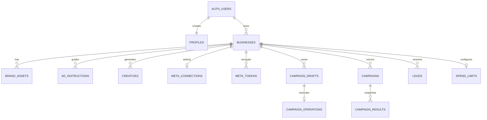

# Data Model and Migrations

The executable reference is [db/schema.sql](../db/schema.sql), a frozen base, plus
every newer file in [db/migrations](../db/migrations/); `node scripts/build-schema.mjs`
prints the full fresh-install schema (see [releasing](RELEASING.md)). Incremental changes
live in [db/migrations](../db/migrations/). [TypeScript rows](../src/lib/types.ts)
are hand-authored, not generated proof of schema parity. Check SQL constraints,
route schemas, and deployed migration state separately.

The [privacy request migration](../db/migrations/20260930_privacy_requests.sql)
adds `public.privacy_requests` for account-owner export/deletion requests and
`private.privacy_request_operators` for explicitly authorized reviewers. RLS
limits customer reads and inserts to the signed-in owner, permits no customer
status changes, and prevents duplicate open requests of the same kind. Only the
server-side service role can read the full queue or update status/handler, after
the privacy operator check. The request itself does not export or delete data.
Meta's data deletion callback also files a `delete` request (`source = 'meta_callback'`,
with the status-URL `confirmation_code` and the Meta person id) through the service-only
`meta_deletion_request_record`: one open request per AdBrain owner who connected that
person, or one with no owner when none did. Meta retries never duplicate it (#730).
In Production it is applied at SHA-256
`02a409069475caff00872c9de31296771d0669bf852f5e5034f7f876a47d972c`, with one
owner-confirmed operator registered and zero requests at readback. This does not
verify the application request workflow; see
[Privacy request operations](OPERATIONS.md#privacy-request-operations).

The source-only [configurable quote migration](../db/migrations/20260927_configurable_payment_quotes.sql)
depends on the original payment, operator policy and
[customer allowance](../db/migrations/20260926_customer_ad_allowance.sql) migrations.
It replaces fixed-total constraints with exact saved-quote checks within 100-1000000
paise; generated payment state and capture/refund effects use each saved total.
An identity trigger prevents repricing accepted orders. Existing default-priced
rows, policies and funding evidence are preserved without backfill.

Generated `purpose` separates annual orders from verification. A second index permits only one verification order per business,
including after refund. #212 replaces the single active annual order with one *open* annual order per business
(unpaid and not superseded); paid orders do not count, so a business can pay again and ad money adds up across
captured orders. `superseded_at` marks an unpaid order replaced by a new amount; it feeds the generated `state`
(`superseded` only while nothing is captured, so a late capture still reads `captured`). Rows are never deleted.
Claims require matching owner/business, current expiry and
exact quote-bound consent. Verification capture is recorded but grants no service
or ad allocation. Verified partial verification refunds need no fictional allocation;
dispute, pending-refund, missing-capture and provider-mismatch holds remain intact.
Annual refund allocation and service earnings are bounded by the stored quote.
Private tables and service-only RPC authority are unchanged. Apply once through
the checksum ledger, not by replaying the canonical schema. After a nondefault
order exists, rollback must retain a quote-aware runtime; see
[pricing operations](CONFIGURATION.md#configurable-live-amounts).

## Relationships

The diagram is conceptual: consult SQL for nullable relationships and delete
actions. In particular, campaign `creative_ids` is a UUID array, **not a set of
foreign keys**. Deleting a creative does not automatically rewrite campaign arrays
or remote ads. The primary-workspace query selects the oldest owned business;
there is no database uniqueness constraint limiting an owner to one business.

The selective live checkout schema adds `private.production_payment_orders`,
`private.production_payment_events`, `private.production_payment_effects` and
conflict records. Apply `20260924_managed_billing.sql` and
`20260924_meta_billing_events.sql` before
`20260926_production_payment_orders.sql`, followed by the additive
`20260926_production_payment_policy_v2.sql`. These four migrations were applied
to the verified AdBrain production target on September 26 at 18:46 UTC; this
does not enable collection.
New `operator-managed-v1` orders have no funding evidence; legacy orders retain
their original evidence and reconciliation rules. Owner claims are atomic and
server-only, and captured funds do not authorize campaign activation. The
canonical schema appends the same policy SQL; verify the migration ledger for
other targets rather than inferring their state from source.

The additive [customer allowance migration](../db/migrations/20260926_customer_ad_allowance.sql)
follows the payment policy and trusted campaign objects in the canonical fresh
schema. It adds five private RLS-protected tables for cumulative campaign
media/tax costs and evidence, campaign reservations, verified refund allocations
and their evidence (`customer_ad_costs`, `customer_ad_cost_evidence`,
`customer_ad_reservations`, `customer_refund_allocations`,
`customer_refund_allocation_evidence`). Direct table access is denied even to
the service role; service-only `customer_ad_*` RPCs verify owner/operator
authority and share the payment transaction lock with refunds. Existing payment orders supply captured/refunded
allocations; test orders do not. Reservations pin the Meta campaign ID and
connection generation, and financially attributed campaigns cannot rebind that
provider ID while paused. Uncertain activation and cost evidence hold funds,
except aging evidence within an open capped reservation's `bounded_media_paise`;
stale non-final evidence holds only while the campaign has an open reservation.
Meta-read evidence (#216) has a null `actor_id` and `input.source='meta'`;
settle reads of a paused run (#221) add `input.settleRead=true`, the
reservation UUID and `final`; two equal reads 30 minutes apart and 3 hours after
the pause finalize the costs and close the reservation;
final reconciliation releases only unused allowance. The
[operator-funded migration](../db/migrations/20261023_operator_funded_businesses.sql)
(#245) adds `private.operator_funded_businesses` (one row per business the
operator funds on Meta: `approved_by`, `approved_at`, `reason`) and the
append-only `private.operator_funding_audit`. Both are RLS-protected and closed
even to the service role; the service-only `operator_funded` and
`operator_funding_set` RPCs read and change them (operator grant required). The
campaign guard lets such a business save `active` without a reservation. Source inclusion alone
does not prove a target migration was applied. See the
[allowance API](API_REFERENCE.md#customer-advertising-allowance) for admission
and recovery limitations.

## Table Dictionary

### Identity and Brand

| Table | Important fields and semantics |
| --- | --- |
| `public.profiles` | Auth-user UUID primary key, email, created timestamp; signup trigger creates profile |
| `public.businesses` | UUID, owner UUID, name, free-text vertical default `local business`; website/description/voice/audience; primary/secondary colors, font, logo URL; language/location/USP/offer arrays; phone/email/address; timestamps |
| `public.brand_assets` | Business UUID, `type` = `logo`/`product_photo`/`past_ad`, URL, optional notes, creation time |
| `public.ad_instructions` | Business UUID, title, Markdown content, active flag, timestamps; active files supply prompt context |
| `public.preference_settings` | `(business_id,owner_id)` key, opt-in/paused state, monotonic epoch; cascade deletes on business or owner deletion |
| `public.declared_preferences` | `(business_id,owner_id,category)` key, one 160-character declared note per category, version/update date; cascades with namespace deletion |

Blank optional form strings become null; list fields split on newlines, not
commas, preserving locations such as `Jaipur, Rajasthan`. Business name is required.
Email validation permits up to 254 characters, phone permits 7-15 digits with
common separators, website allows a bare domain or HTTP(S) URL (saved as a full link:
`vanshul.com` → `https://vanshul.com`, paths kept, other schemes rejected; older bare
rows are read the same way by Prepare and the Meta ad link, #470), and logo requires
an absolute HTTP(S) URL. These validators do not prove a remote resource is public
or safe; outbound fetch policy is separate. Profile fields do not all have strict
database length bounds; prompt builders truncate selected fields independently.

### Creative and Campaign Data

| Table | Important fields and semantics |
| --- | --- |
| `public.creatives` | Business, brief, angle, headline, primary text, CTA, image URL, `variant_group` UUID, status `draft`/`approved`, optional `generation` JSON, timestamps |
| `public.campaigns` | Business, name, objective, total daily budget, status `draft`/`active`/`paused`/`completed`, creative UUID array, Meta campaign/adset/ad IDs, account/Page/generation binding, raw metadata, launch/create times |
| `public.managed_meta_accounts` | #519 (2-Tier, #518): one row per business AdBrain provisions under Solaride. `state` `requested` → `page_linked` → `child_created` → `ad_account_created` → `funded` → (`whatsapp_linked`) → `ready`, or `failed` (resumes) / `offboarding` → `offboarded`; a trigger enforces the transitions and each state's required Meta IDs. Rows start at `requested` (insert guard); `offboarding` only goes to `offboarded`. `page_id` and `phone_number_id` unique among active (not offboarded) tenants; unique `child_business_id`, unique `act_` `ad_account_id` (both fixed once set); `waba_id`, `whatsapp_number_e164` (#524 v1: the Page-linked number; unique among active tenants; `whatsapp_linked` needs it or `waba_id` + `phone_number_id`), `funding_state`, per-step `step_keys` (each value a key pattern, never a token), `last_error` (a code only), `manager_user_id` (the child's own system user) and `manager_token_id` (a reference into `private.meta_tokens`, same business by composite key), and a provisioning lease (`managed_meta_account_claim`/`_release`, service only, database time). Never tokens. Owners read their own row; only the service role writes. The business can't be deleted until the account is offboarded |
| `private.managed_spend_caps` | #522: one row per managed child ad account (business FK, `on delete restrict`): the writer lease (`lease_token`, `lease_until`), a stale mark (`dirty`) and the last spending limit decision (`action` set/keep/freeze/stop, `cap_paise`, `room_paise`). No API-role access; service-role functions `managed_spend_cap_request/begin/finish/abandon/state/inputs` check the ad account is the tenant's own managed one; `managed_spend_cap_mark_stale` (by business) and `_mark_payment_stale` (by payment or provider order) mark it stale on a money event, and `managed_spend_cap_due` orders the sweep (stale first, then oldest decision) |
| `public.whatsapp_number_bindings` | #253: the WhatsApp numbers an AdBrain business may send click-to-WhatsApp ads to, besides its Page's own. Key (`business_id`, `phone_e164`); `source` `owner_pick` (bound at Prepare from the business's own Meta connection; never for a managed account) / `embedded_signup` / `page_link`; optional `waba_id`, `phone_number_id`. Numbers and Meta IDs only, never tokens. Owners read their own rows; only the service role writes; removed with the business |
| `public.campaign_learnings` | #588 learning ledger: one row per launched campaign (`campaign_id` PK, cascades). `snapshot` jsonb (≤ 16 KB): the settings the launch sent (destination, objective, budget, areas/ages/gender/interests, Advantage+ audience, formats, WhatsApp prefill text and language, creatives with angle and models). Version 2 (#672) records `advantage_audience` as sent (1/0, null if unknown or mixed), `metaCreativeIds`, and `cap` (lifetime rupees, days, end time) once a capped run's activation is confirmed; `campaigns.launched_at` is that first confirmed activation; `hypothesis` and `verdict` (≤ 500 chars, QA 2). Outcomes stay in `campaign_results`. No lead data, never tokens. Owners read their own rows; only the service role writes |
| `public.campaign_edit_operations` | #773: the envelope of an edit to a launched campaign, apart from `campaign_operations` (whose readers treat every row as a launch with a draft). One row per `(business_id, campaign_id, idempotency_key)` (key = campaign + digest of the change, 8-200 chars); `kind` `audience`\|`budget`; `state` `pending`\|`running`\|`succeeded`\|`failed`\|`needs_reconciliation`; `phase` `validate`\|`edit`\|`mirror`\|`complete`; `transmitted` is set right before the first Meta write; `before`, `change`, `result` jsonb (≤ 64 KB, settings and ids only), `sanitized_error` (≤ 500). Cascades with the campaign. Owners read their own rows; only the service role writes |
| `public.managed_meta_account_events` | Append-only (trigger) log per provisioning step: business, `step`, `outcome`, request ID, idempotency key, Meta object ID, error code. Owners read their own; only the service role inserts |
| `public.campaign_results` | Campaign FK, impressions/clicks/leads, spend, nullable CPL, nullable conversations/cost-per-conversation, nullable `whatsapp_opens` (Meta `link_click` on WhatsApp ads, #493), destination/period, fetch timestamp; ownership follows campaign -> business |
| `public.campaign_drafts` | Business/owner, version >= 1, input JSON, expiry, creation/update times; composite unique `(business_id,id)` |
| `public.campaign_operations` | Business/draft/version/generation, kind `campaign_create`, idempotency key, request hash, state/phase, lease, attempt count, payload/result/external IDs, sanitized error, timestamps |

Creative receipt JSON records generation settings and provenance; it is not a
provider credential store. Ads made since #280 also keep the overlay `design`
spec (without `backgroundUrl`) and the stored background `photoUrl`, so the words
on the picture can be re-rendered without the AI; `generation.concept.description`
holds the owner-editable link description. Ads made since #451 also store `requestId`
(the Create run that first made the ad, kept through regenerations) and `angleId`, which link the
ad to its `llm_usage_events` rows; later changes' rows carry `metadata.creativeId`.
`variant_group` is indexed, not unique: a generation
UUID groups rows but does not prevent duplicate paid POSTs.

Campaign uniqueness is `(business_id, meta_campaign_id)` for non-null Meta IDs.
Two businesses can deliberately mirror the same external campaign. Never merge
or deduplicate across tenants based solely on a Meta ID. Daily budget is numeric
in SQL while new API inputs are whole rupees; synced historical values can differ.

Operation identity is unique on `(business_id,kind,idempotency_key)` and on
`draft_id`. One draft cannot quietly spawn unrelated operations under new keys.
States: `pending`, `running`, `succeeded`, `failed`, `needs_reconciliation`.
Phases: `campaign`, `adset`, `creative`, `ad`, `reconcile`, `complete`.
Draft FK deletion is restricted while an operation references it; campaign FK
deletion sets operation `campaign_id` null while retaining recovery evidence.

Reporting migrations add `destination` to campaigns and snapshots with a constrained
set of `instant_form`, `whatsapp`, `call`, `mixed`, `unknown` (default).
Snapshot `period_start`/`period_end` record provider dates when available; legacy
rows remain null. No historical range or destination is invented. A snapshot's
known destination wins over the campaign's current destination; unknown snapshots
can fall back to current/legacy evidence, so historical reclassification is not exact.
These fields do not make the spend cap a calendar-week accounting system.
Campaign lists use an index on `(business_id,created_at desc,id desc)`.

Worker jobs use existing operation rows with `payload.execution='worker'` and a
validated reviewed request. A partial pending index supports queue claims. No
second job table can diverge from the operation's idempotency and recovery state.
`private.schema_migrations` records approved named migrations and SHA-256 checksums;
it is administrator-only and does not retroactively catalog earlier deployments.

### Connections and Secrets

| Table | Important fields and access |
| --- | --- |
| `private.meta_tokens` | Business/authorizer/subject; token kind `user`/`business_system_user`/`page`; ciphertext, 12-byte nonce, 16-byte tag, key ID/format version; granted scopes/assets; expiration, validation, revocation timestamps |
| `private.meta_connection_attempts` | Business/user/token reference; unique state hash, browser-binding hash, status, intent, expected generation, revision, discovered assets/completeness, error code, claim/expiry/create timestamps |
| `public.meta_connections` | One row per business; selected Meta business/account/Page, names, currency/timezone, token reference, authorization state, capability JSON, selection reason, generation and check/update times |

The composite `(business_id,token_id)` FK prevents a connection from referring to
another tenant's token row. Private tables deny direct browser access and even
direct service-role table operations; narrowly granted security-definer RPCs
mediate token/attempt access. Connection metadata is served through authorized
server DTOs, not unrestricted client reads.

Legacy `meta_credentials` may exist in upgraded installations. Nothing reads or writes
it, and browsers have no access (#731). It is not the current publishing credential source. Do not
backfill binding IDs from global environment settings or expose legacy token
columns to restore an obsolete UI.

### Leads, Limits, and Evidence

| Table | Important fields and guarantees |
| --- | --- |
| `public.leads` | Business, nullable campaign, `source` `meta_form` (default) or `whatsapp_manual` ([#335 migration](../db/migrations/20261024_manual_whatsapp_enquiries.sql)); `meta_lead_id` is null exactly for `whatsapp_manual` rows the owner logs from WhatsApp chats; unique `(business_id,meta_lead_id)` for Meta leads, form ID/name, normalized name/phone/email/city, field JSON, provider creation time and import time; `workflow_status` `new`/`contacted`/`qualified`/`booked`/`closed` (default `new`) and `follow_up_note` (default empty, <=2000 characters) |
| `public.lead_sync_runs` | Business/owner, connection generation, ad account and Page, state `partial`/`complete`, version, progress JSON (form cursor, seen forms, pending forms); RLS with browser roles revoked, service-role only |
| `public.spend_limits` | One per business; nullable integer weekly cap, alert percentage 1-100 default 80, auto-pause default false, updated time |
| `public.audit_log` | Business/actor, action, entity type/ID, Meta object ID, reason, detail JSON, timestamp |
| `public.llm_usage_events` | Business/user/request, route, text/image kind, provider/model, tokens, estimated USD, prompt version, character counts, temperature/max tokens, cache/latency/attempt/status/error, image dimensions, metadata, timestamp; new candidate metadata binds a generation UUID to bounded provider request IDs and provider finality when available |
| `public.rate_limit_hits` | Limiter key and hit timestamp, indexed by both |
| `public.product_events` | Event/request UUIDs, version 1, optional user/business, kind/name/outcome/duration, allowlisted attributes, timestamp |
| `public.product_event_daily` | Account-free daily usage/performance totals, grouped by UTC day/environment/release/event/route/action/viewport/provider/model; RLS, browser access denied, service-role read only |

The source [rollup migration](../db/migrations/20260928_product_event_rollups.sql)
depends only on the existing product-event table and replaces its pruning function
without changing the caller contract. It aggregates and deletes up to 10,000 raw
events older than 90 days atomically, preserves aggregate totals for 730 UTC days,
and bounds old-aggregate cleanup. Migration application itself deletes no events.
Use the [observability guide](OBSERVABILITY.md#retention-and-health) for metrics,
privacy, retention limitations and queries spanning raw and aggregate data.

Leads use duplicate-ignore inserts, so later provider edits do not update an
existing lead, and repeated imports keep its campaign and follow-up fields.
Campaign deletion sets lead `campaign_id` null rather than deleting
the enquiry. Contact data remains personal data; do not put it in telemetry.

Lead sync progress lives in `lead_sync_runs`. Service-only `lead_sync_start`
resumes or creates a run bound to the business owner and the current connected
generation/account/Page; `lead_sync_checkpoint` inserts up to 200 rows and
advances progress in one transaction, rejecting a stale version or changed
binding. A run becomes `complete` only when form discovery is done and no forms
are pending. Browser roles cannot supply progress. Each row may carry Meta's
`meta_campaign_id`; the checkpoint sets `leads.campaign_id` to this business's
campaign with that Meta id (null for test or organic leads), fills an empty link
on a lead seen again, and counts only new leads as imported (#680).

`get_lead_page` is security-invoker, owner-checked and granted to authenticated
only, so RLS still applies. It filters by status, contact availability and a
case-insensitive search over name/phone/email/city/form, and returns rows, the
exact filtered total and a keyset position. Microsecond time keys, C-collated
names, missing values last and UUID tie-breakers give deterministic continuation,
not a frozen snapshot under concurrent edits.

The API and integrity SQL require a positive integer spend cap or null.
Integrity constraints also reject negative/nonfinite campaign budgets and costs,
unsafe metric counts and invalid reporting periods. Composite foreign keys bind
lead/operation campaigns and operation drafts to the same business. On upgrade
these are added `NOT VALID`: new writes are checked, historical rows are not
certified until the separate validation migration runs after the
[read-only preflight](../db/preflight/20260926_campaign_integrity.sql) and any
approved repair. They do not establish a spend ledger.

Audit rows are owner-readable, not owner-insertable. Inspect `authority` before
treating historical rows as server evidence. This is not a cryptographically
tamper-proof audit system; database administrators and cascades remain relevant.
Legacy audit details can include brief text; product-event privacy rules are not
retroactive sanitization of that store.

Usage inserts are service-only; owners can select their own rows. The nonnegative
constraint is added `NOT VALID` for upgrade compatibility: new writes are checked,
but old data requires a separate validation decision. Monthly aggregation is
owner-scoped and sums all relevant rows, avoiding client pagination truncation.
Persistence is best effort and estimated costs are not invoices.

The deployed #54 [creative-generation intents](../db/migrations/20260927_creative_generation_intents.sql)
bind a UUID to one
business, owner, request hash and expected count, a UTC month, reserved/accounted
quota units, an image allowance and a persisted state. Direct table access is
revoked; service-only admission, status and progress RPCs verify current
ownership. Admission serializes same-ID claims and business/month quotas against
recorded usage plus outstanding holds. Completion releases unused text allowance
but retains 10,000 units per completed image; paid image rows carry zero tokens,
and their estimated USD costs may be unknown. Unresolved work keeps its ID and
hold across restarts and months. Only a settled whole-request failure with no
saved results can release unused reservation; one failed angle cannot fail the
intent while sibling work remains in flight. After the
[settle-holds migration](../db/migrations/20261021_creative_generation_settle_holds.sql)
(#138), a settled partial run whose every angle recorded its usage keeps only
that usage plus 10,000 units per saved image; runs with unknown usage stay
`unresolved` with their full hold. An unknown owner recovery lookup claims a
zero-quota `abandoned` ID under the same lock, preventing a delayed POST from
starting after the client receives a 404. This is a conservative quota fence, **not** a
payment ledger or provider cost reconciliation. The [API contract](API_REFERENCE.md#generate-and-recover)
defines the client-visible recovery states.

The [operator reconciliation migration](../db/migrations/20260930_creative_generation_reconcile.sql)
is applied in Production at checksum `99d1be625171c48dee4cbe7bec71d749169742a2a49b2c113dd1cd36c2f6f681`.
It adds a private one-row-per-intent audit and a service-role-only, owner/intent-scoped
RPC. It fences older intents without generation-bound receipts, requires an
operator evidence reference, explicit provider-verified token total, matching
saved-creative outcome and current accounted/reserved counters, then atomically
writes any missing usage adjustment and closes the hold. No browser caller can
invoke it; row-locking triggers reject late generation-bound usage writes and
new/reassigned creatives, while ordinary saved creative edits remain available.
A late progress callback cannot change an audited result. The
SQL cannot independently verify external provider finality: the authorized
operator must do that before calling. In particular it cannot reconcile the
September 29 #54 incident, whose per-generation provider evidence is still absent.

The [regeneration claims migration](../db/migrations/20261001_creative_regeneration_claims.sql)
adds one private claim per creative, bound to the current business, owner and
request UUID. Service-only RPCs atomically admit one paid regeneration at a time
across server instances and release the claim after a confirmed save or known
pre-provider failure. An uncertain paid outcome stays `unresolved`; it cannot
auto-expire or be cleared by an authenticated client. This is not a provider
idempotency key or a substitute for external outcome evidence. Apply the migration
before serving the updated regeneration route.

Product events are server-only (no browser read/write policy), with bounded JSON
attributes and a 90-day retention target. Pruning deletes at most 10000 old rows
per call. See [Observability](OBSERVABILITY.md) for exceptions and retention backlog.

### Effective Authority

Authenticated owners can read their campaign, result and audit rows but cannot
insert, update or delete them; server callers write after owner/binding checks.
Business delete/truncate is revoked from browser roles so cascades cannot remove
retained evidence. Audit insertion goes through service-only
`append_verified_audit_event`, which verifies the business owner or an explicit
`cron`/`worker` system actor, assigns the label/time and sets `authority=server`;
older rows stay `legacy_unverified`, and direct service-role audit writes are
revoked. Draft owners keep select/insert, but an insert trigger sets
version/expiry and a 50-open-draft limit, and update/delete go through
version-checked RPCs. RLS and grants both apply: an `all own` policy is not
evidence of write access after a revoke. Sources:
[trusted writes](../db/migrations/20260926_trusted_campaign_writes.sql) and
[draft authority](../db/migrations/20260926_draft_authority.sql).

### Optional Payment Storage

These migration-defined tables support billing evidence and local test checkout.
They do not implement campaign activation authority; see the
[Payment Plan](PAYMENTS-PLAN.md).

| Table | Persistence / authority |
| --- | --- |
| `public.meta_billing_profiles` | Business/environment billing identity; owner-readable, service select/insert |
| `public.meta_funding_evidence` | Append-oriented verified funding evidence; service select/insert |
| `public.meta_funding_revocations` | Separate revocation records; original evidence is not rewritten |
| `public.meta_billing_events`, `public.meta_billing_event_conflicts` | Provider charge observations and conflicting evidence, not an account balance; service read, RPC-mediated writes; migration-only, not in the fresh schema |
| `private.razorpay_test_orders`, `private.razorpay_test_events` | Fixed-amount INR test orders and deduplicated observations; migration-only, not in the fresh schema |

Test order/event tables deny direct access even to the service role; only the
`razorpay_test_order_*` RPCs reach them. Test order states are `creating`,
`created`, `captured` and `needs_reconciliation`. A capture is not Meta funding
or spendable credit, and installing the tables does not enable checkout; see
[local test payments](API_REFERENCE.md#local-test-payments).

## RPC Ownership Boundaries

| RPC family | Purpose |
| --- | --- |
| `owns_business` | Current authenticated owner predicate |
| `change_declared_preferences` | Owner-checked, namespace-locked opt-in/save/forget/clear/pause with monotonic epoch; only authenticated callers can execute and direct table writes are denied |
| `meta_token_*` | Business-bound encrypted token insertion/read/delete |
| `meta_attempt_*` | OAuth claim, discovery, revision, selection commit and failure transitions |
| `meta_disconnect`, `meta_revoke_subject` | Disconnect/revoke and invalidate connection generation (revoke clears only connections using that Meta user's token) |
| `update_campaign_draft_if_version`, `delete_campaign_draft_if_version` | Authenticated owner/version-checked draft update/delete; update blocks unsafe operation overlap; direct update/delete revoked |
| `append_verified_audit_event` | Service-only verified actor/time/provenance audit insertion |
| `get_lead_page` | Authenticated, owner-checked filtered enquiry page with total and keyset position |
| `lead_sync_start`, `lead_sync_checkpoint` | Service-only binding-checked sync run resume and atomic lead import/progress commit |
| `claim_campaign_operation` | Durable idempotency/lease claim |
| `enqueue_campaign_operation`, `claim_next_campaign_job` | Service-only durable enqueue and exclusive pending-job claim |
| `checkpoint_campaign_operation` | Fenced phase and external-ID persistence |
| `finish_campaign_operation`, `fail_campaign_operation`, `expire_campaign_operation` | Terminal/reconciliation transitions |
| `monthly_token_usage` | Security-invoker, owner-RLS monthly sum |
| `creative_generation_admit/status/progress` | Deployed #54 service-only, owner-checked generation claim, recovery and quota holds |
| `creative_generation_reconcile` | Production service-only operator-attested settlement after external finality and token verification; legacy intents denied |
| `creative_regeneration_claim/finish` | Migration-dependent service-only, owner-checked per-creative paid-operation claim and guarded release/hold |
| `check_rate_limit` | Service-only advisory-lock-protected count and insert |
| `prune_product_events` | Service-only bounded retention cleanup |
| `customer_ad_*` | Service-only allowance balance, reservation, activation result, cost reconciliation and refund allocation |
| `meta_funding_latest_record` | Service-only business/environment funding evidence lookup |
| `meta_billing_event_record`, `meta_billing_charge_observations` | Service-only billing event/conflict persistence and observation lookup |
| `razorpay_test_order_claim/result/get/find/observe` | Service-only local test order creation, recovery and verified observations |

Do not expose service RPCs as arbitrary browser-callable utilities. SQL grants and
application owner checks serve different purposes and both must remain intact.
See [database tests](../scripts/check-meta-connect-db.mjs) before changing fences.

## Storage

Both `brand-assets` and `creatives` buckets are configured **public**. Object
management is scoped by an owned business UUID as the first path segment, but a
public delivery URL is not a private authenticated download. Do not upload
confidential documents, lead lists, credentials, or unconsented personal media.

Generated media uses `<businessId>/<variantGroup>/<name>-<randomUUID>.png` after
raster normalization. The brand-upload UI accepts PNG/JPEG/WebP up to 5 MiB;
this is a UI guard, not proof of server-wide bucket validation. The shared
server image pipeline has different 20 MiB/40-million-pixel limits.

Deleting a database row does not automatically remove a Storage object. Creative
deletion currently removes the row, not a complete media-retention graph. Brand
asset deletion explicitly coordinates row/reference/file operations but cannot
make them atomic. Cleanup must check campaign/draft/operation references and
retain recovery evidence; never remove media based only on a missing current UI
thumbnail.

## Migration Map

Apply only missing, reviewed migrations for the verified target. Filename order
alone is not a safe deployment plan.

| Migration | Scope / prerequisite |
| --- | --- |
| [001_harden_meta_credentials.sql](../db/migrations/001_harden_meta_credentials.sql) | Historical legacy credential privilege hardening; inspect applicability to existing legacy table/readers |
| [20260906_creative_generation.sql](../db/migrations/20260906_creative_generation.sql) | Creative generation receipts and usage persistence |
| [20260907_meta_instant_connect.sql](../db/migrations/20260907_meta_instant_connect.sql) | Private token/attempt storage, connection metadata and RPCs |
| [20260907_campaign_connect.sql](../db/migrations/20260907_campaign_connect.sql) | Requires connection schema; drafts, durable operations, campaign bindings and fences |
| [20260916_trusted_usage_and_rate_limits.sql](../db/migrations/20260916_trusted_usage_and_rate_limits.sql) | Trusted usage privileges, quota aggregate, atomic shared limiter |
| [20260918_product_events.sql](../db/migrations/20260918_product_events.sql) | Structured event table/retention; enable database logging only after application |
| [20260918_whatsapp_results.sql](../db/migrations/20260918_whatsapp_results.sql) | Nullable conversation metrics; required before callers write WhatsApp results |
| [20260919_campaign_reporting_identity.sql](../db/migrations/20260919_campaign_reporting_identity.sql) | Destination/period columns and campaign-list index; historical values stay `unknown`/null |
| [20260919_campaign_worker.sql](../db/migrations/20260919_campaign_worker.sql) | Requires campaign operations; service enqueue/claim RPCs before worker mode |
| [20260924_managed_billing.sql](../db/migrations/20260924_managed_billing.sql) | Billing profiles, funding evidence and revocations |
| [20260924_meta_billing_events.sql](../db/migrations/20260924_meta_billing_events.sql) | Billing observation/conflict storage; managed billing first |
| [20260926_campaign_integrity.sql](../db/migrations/20260926_campaign_integrity.sql) | Requires WhatsApp metrics and reporting identity; `NOT VALID` checks and same-business FKs |
| [20260926_validate_campaign_integrity.sql](../db/migrations/20260926_validate_campaign_integrity.sql) | Validates those constraints; only after the preflight and approved repair |
| [20260926_draft_authority.sql](../db/migrations/20260926_draft_authority.sql) | Draft insert trigger and RPC-only update/delete; deploy with compatible callers |
| [20260926_trusted_campaign_writes.sql](../db/migrations/20260926_trusted_campaign_writes.sql) | Revokes owner campaign/result/audit writes; adds verified audit RPC; deploy with server callers |
| [20260926_lead_sync_progress.sql](../db/migrations/20260926_lead_sync_progress.sql) | `lead_sync_runs` and service-only sync RPCs; before resumable lead sync |
| [20260926_lead_follow_up.sql](../db/migrations/20260926_lead_follow_up.sql) | Lead workflow status/note, inbox indexes and `get_lead_page`; before the enquiry inbox routes |
| [20260926_razorpay_test_orders.sql](../db/migrations/20260926_razorpay_test_orders.sql) | Local test orders/events and service RPCs; never live activation |
| [20260930_declared_preferences.sql](../db/migrations/20260930_declared_preferences.sql) | Additive opt-in personal/business memory; apply before exposing Settings controls or relying on retrieval |
| [20261001_creative_regeneration_claims.sql](../db/migrations/20261001_creative_regeneration_claims.sql) | Service-only paid regeneration fence; apply before serving the updated route and verify private grants |
| [20261021_creative_generation_settle_holds.sql](../db/migrations/20261021_creative_generation_settle_holds.sql) | Same-signature progress RPC; settled partial runs release unused holds (#138); apply before serving the updated route |
| [20261022_payment_webhook_health.sql](../db/migrations/20261022_payment_webhook_health.sql) | Service-only `production_payment_webhook_health` counts (#178); apply before serving `/api/cron/payment-health` |
| [20261022_meta_revoke_subject_scope.sql](../db/migrations/20261022_meta_revoke_subject_scope.sql) | Same-signature service-only `meta_revoke_subject`; deauthorize clears only connections using that Meta user's token (#181) |
| [20261023_meta_cost_settle.sql](../db/migrations/20261023_meta_cost_settle.sql) | Service-only `customer_ad_settle_costs` and `customer_ad_settling_businesses`, evidence campaign index, balance no longer held by a settling run's stale evidence (#221); apply before serving the updated `enforce-spend` sweep |
| [20261024_scheduler_pg_cron.sql](../db/migrations/20261024_scheduler_pg_cron.sql) | `pg_cron` + `pg_net` jobs calling the cron routes on time (#274): enforce-spend, sync-leads and refresh-results every 15 min (refresh-results reads each campaign at most hourly); owner-only `private.call_cron_route` reads `adbrain_cron_secret` from Vault and is a no-op without it; skipped where `pg_cron`/`pg_net` are not preloaded |
| [20261024_security_advisors.sql](../db/migrations/20261024_security_advisors.sql) | Advisor hardening (#359): `owns_business` becomes SECURITY INVOKER (same answer), `handle_new_user` trigger not executable by API roles, fixed `set_updated_at` search path, 8 RLS policies use `(select auth.uid())` (same predicates), indexes on lead/operation/connection tenant foreign keys |
| [20261024_whatsapp_opens.sql](../db/migrations/20261024_whatsapp_opens.sql) | Additive nullable `campaign_results.whatsapp_opens` (>= 0, #493); release before the code that writes it |
| [20261025_managed_meta_accounts.sql](../db/migrations/20261025_managed_meta_accounts.sql) | #519 2-Tier ledger: `managed_meta_accounts` (state machine trigger, fixed Meta IDs, owner-read RLS, service-role writes) and append-only `managed_meta_account_events` |
| [20261025_managed_provision_lease.sql](../db/migrations/20261025_managed_provision_lease.sql) | #521 wiring: `managed_meta_accounts.manager_user_id`/`manager_token_id` (composite FK to the same business's `meta_tokens`), provisioning lease and service-only claim/release RPCs |
| [20261025_managed_spend_caps.sql](../db/migrations/20261025_managed_spend_caps.sql) | #522: `private.managed_spend_caps` writer lease and last decision per managed child ad account, and service-role functions to claim, run, finish or abandon a pass, read the gate state and the tenant's attributed media per ad account |
| [20261025_managed_whatsapp_page_link.sql](../db/migrations/20261025_managed_whatsapp_page_link.sql) | #524 v1: `managed_meta_accounts.whatsapp_number_e164` (the Page-linked, Meta-verified number); `whatsapp_linked` needs it or the Embedded Signup IDs; one active customer per number |
| [20261025_whatsapp_number_bindings.sql](../db/migrations/20261025_whatsapp_number_bindings.sql) | #253 number boundary: `whatsapp_number_bindings` (owner-read RLS, service-role writes) |
| [20261026_campaign_learnings.sql](../db/migrations/20261026_campaign_learnings.sql) | #588 learning ledger: `campaign_learnings` (owner-read RLS, service-role writes) |
| [20261026_campaign_edit_operations.sql](../db/migrations/20261026_campaign_edit_operations.sql) | #773: `campaign_edit_operations` (owner-read RLS, service-role writes) |
| [20261026_campaign_edit_operations_ad_creative.sql](../db/migrations/20261026_campaign_edit_operations_ad_creative.sql) | #775: `campaign_edit_operations.kind` also allows `ad_creative` (an ad's words edited through a new creative); ad and creative ids live in `before`/`change`/`result`; additive, after #835 |
| [20261026_campaign_ads_ad_results.sql](../db/migrations/20261026_campaign_ads_ad_results.sql) | #783/#789 results per ad: `campaign_ads` (ad → Meta creative / AdBrain creative, variant and position; written at Launch) and `ad_results` (lifetime-to-date impressions, link clicks, chats, leads and spend in paise per ad; `delivered=false` rows for ads Meta hasn't shown; unique per campaign, ad and period with nulls not distinct). Both owner-read RLS, service-role writes, `(business_id, campaign_id)` FK to `campaigns(business_id, id)` (adds that key if missing), cascade on campaign delete. No lead data; additive, any release order |
| [20261026_meta_token_search_path.sql](../db/migrations/20261026_meta_token_search_path.sql) | #625: `meta_token_insert`/`get`/`delete` run with `search_path = ''` (#359 standard); bodies already fully qualified, behaviour unchanged |
| [20261026_lead_campaign_link.sql](../db/migrations/20261026_lead_campaign_link.sql) | Same-signature `lead_sync_checkpoint` links synced leads to their campaign by Meta campaign id and backfills empty links (#680); either release order works (the old function ignores the new key) |
| [20261026_business_whatsapp_template.sql](../db/migrations/20261026_business_whatsapp_template.sql) | #840: nullable `businesses.whatsapp_template` jsonb (object, ≤ 4 KB), the business's WhatsApp opening (greeting + pre-typed message with optional Call now, or ≤ 3 questions; the app validates it with zod in #840 step 3); covered by the owner policy; additive, any release order |
| [20261026_meta_deletion_requests.sql](../db/migrations/20261026_meta_deletion_requests.sql) | #730: `privacy_requests` gains `source`, `confirmation_code`, `meta_subject_id` (nullable `owner_id` only for callback rows); service-only `meta_deletion_request_record` files the callback's deletion request, idempotent per open code and owner |
| [20261026_legacy_credentials_bucket_limits.sql](../db/migrations/20261026_legacy_credentials_bucket_limits.sql) | #731: revoke browser access to legacy `meta_credentials` (when present); `brand-assets` 10 MB and `creatives` 20 MB, PNG/JPEG/WebP only |
| [20261026_meta_connection_reauth.sql](../db/migrations/20261026_meta_connection_reauth.sql) | #757: service-only `meta_connection_mark_reauth(business, generation)` marks a `connected` connection `reauth_required` after a Graph 190, only at the generation that failed |

Payment, allowance and quote migrations are described above. The map is not a
replay script: a fresh database starts from the canonical schema, and
already-represented incremental files must not be blindly reapplied. The
[migration runner](../scripts/database-migrations.mjs) needs explicit connection
settings (an exact `--target` and verified TLS for remote hosts), serializes
runs with an advisory lock, records each SHA-256 checksum and rejects a changed
already-applied file.

For each upgrade: inventory deployed objects and grants, review existing data,
test fresh/repeated-upgrade/concurrency paths locally, prepare backup and code
compatibility, get remote-migration authorization, apply transactionally as
appropriate, verify grants/RPCs, and reload PostgREST schema cache if needed.
An additive migration can still change permissions and break old code.

Code rollback does not reverse database writes or decrypt tokens with a different
key. Preserve encrypted-key access, operation history, and existing binding facts.
There is no general automated destructive down-migration workflow. Follow
[Release Workflow](RELEASING.md) for environment changes.