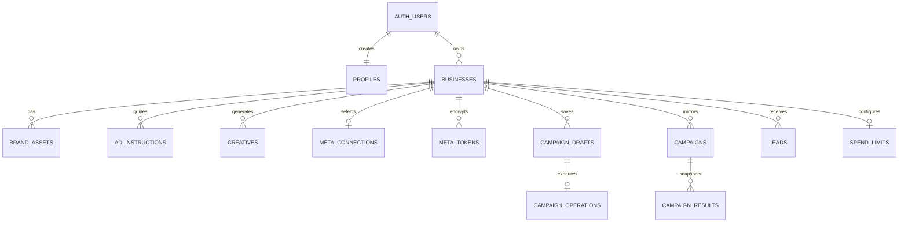

# Data Model and Migrations

Part of [Architecture](README.md). [Tables and relationships](data-model.md) · [Leads, authority, RPCs and storage](data-model-access.md) · [Migrations](migrations.md).

The executable reference is [db/schema.sql](../../db/schema.sql), a frozen base, plus
every newer file in [db/migrations](../../db/migrations/); `node scripts/build-schema.mjs`
prints the full fresh-install schema (see [releasing](../operations/releasing.md)). Incremental changes
live in [db/migrations](../../db/migrations/). [TypeScript rows](../../src/lib/types/) (one file per
domain, re-exported by `src/lib/types.ts`, #1824) are hand-authored, not generated proof of schema parity. Check SQL constraints,
route schemas, and deployed migration state separately.

The [privacy request migration](../../db/migrations/20260930_privacy_requests.sql)
adds `public.privacy_requests` for account-owner export/deletion requests and
`private.privacy_request_operators` for explicitly authorized reviewers. RLS
limits customer reads and inserts to the signed-in owner, permits no customer
status changes, and prevents duplicate open requests of the same kind. Only the
server-side service role can read the full queue or update status/handler, after
the privacy operator check. The request itself does not export or delete data.
Meta's data deletion callback also files a `delete` request (`source = 'meta_callback'`,
with the status-URL `confirmation_code` and the Meta person id) through the service-only
`meta_deletion_request_record`: one open request per AdBrain owner who connected that
person, or one with no owner when none did. Meta retries never duplicate it (#730).
In Production it is applied at SHA-256
`02a409069475caff00872c9de31296771d0669bf852f5e5034f7f876a47d972c`, with one
owner-confirmed operator registered and zero requests at readback. This does not
verify the application request workflow; see
[Privacy request operations](../operations/privacy-requests.md#privacy-request-operations).

The source-only [configurable quote migration](../../db/migrations/20260927_configurable_payment_quotes.sql)
depends on the original payment, operator policy and
[customer allowance](../../db/migrations/20260926_customer_ad_allowance.sql) migrations.
It replaces fixed-total constraints with exact saved-quote checks within 100-1000000
paise; generated payment state and capture/refund effects use each saved total.
An identity trigger prevents repricing accepted orders. Existing default-priced
rows, policies and funding evidence are preserved without backfill.

Generated `purpose` separates annual orders from verification. A second index permits only one verification order per business,
including after refund. #212 replaces the single active annual order with one *open* annual order per business
(unpaid and not superseded); paid orders do not count, so a business can pay again and ad money adds up across
captured orders. `superseded_at` marks an unpaid order replaced by a new amount; it feeds the generated `state`
(`superseded` only while nothing is captured, so a late capture still reads `captured`). Rows are never deleted.
Claims require matching owner/business, current expiry and
exact quote-bound consent. Verification capture is recorded but grants no service
or ad allocation. Verified partial verification refunds need no fictional allocation;
dispute, pending-refund, missing-capture and provider-mismatch holds remain intact.
Annual refund allocation and service earnings are bounded by the stored quote.
Private tables and service-only RPC authority are unchanged. Apply once through
the checksum ledger, not by replaying the canonical schema. After a nondefault
order exists, rollback must retain a quote-aware runtime; see
[pricing operations](../operations/configuration-payments.md#configurable-live-amounts).

## Relationships

The diagram is conceptual: consult SQL for nullable relationships and delete
actions. In particular, campaign `creative_ids` is a UUID array, **not a set of
foreign keys**. Deleting a creative does not automatically rewrite campaign arrays
or remote ads. The primary-workspace query selects the oldest owned business;
there is no database uniqueness constraint limiting an owner to one business.

The selective live checkout schema adds `private.production_payment_orders`,
`private.production_payment_events`, `private.production_payment_effects` and
conflict records. Apply `20260924_managed_billing.sql` and
`20260924_meta_billing_events.sql` before
`20260926_production_payment_orders.sql`, followed by the additive
`20260926_production_payment_policy_v2.sql`. These four migrations were applied
to the verified AdBrain production target on September 26 at 18:46 UTC; this
does not enable collection.
New `operator-managed-v1` orders have no funding evidence; legacy orders retain
their original evidence and reconciliation rules. Owner claims are atomic and
server-only, and captured funds do not authorize campaign activation. The
canonical schema appends the same policy SQL; verify the migration ledger for
other targets rather than inferring their state from source.

The additive [customer allowance migration](../../db/migrations/20260926_customer_ad_allowance.sql)
follows the payment policy and trusted campaign objects in the canonical fresh
schema. It adds five private RLS-protected tables for cumulative campaign
media/tax costs and evidence, campaign reservations, verified refund allocations
and their evidence (`customer_ad_costs`, `customer_ad_cost_evidence`,
`customer_ad_reservations`, `customer_refund_allocations`,
`customer_refund_allocation_evidence`). Direct table access is denied even to
the service role; service-only `customer_ad_*` RPCs verify owner/operator
authority and share the payment transaction lock with refunds. Existing payment orders supply captured/refunded
allocations; test orders do not. Reservations pin the Meta campaign ID and
connection generation, and financially attributed campaigns cannot rebind that
provider ID while paused. Uncertain activation and cost evidence hold funds,
except aging evidence within an open capped reservation's `bounded_media_paise`;
stale non-final evidence holds only while the campaign has an open reservation.
Meta-read evidence (#216) has a null `actor_id` and `input.source='meta'`;
settle reads of a paused run (#221) add `input.settleRead=true`, the
reservation UUID and `final`; two equal reads 30 minutes apart and 3 hours after
the pause finalize the costs and close the reservation;
final reconciliation releases only unused allowance. The
[operator-funded migration](../../db/migrations/20261023_operator_funded_businesses.sql)
(#245) adds `private.operator_funded_businesses` (one row per business the
operator funds on Meta: `approved_by`, `approved_at`, `reason`) and the
append-only `private.operator_funding_audit`. Both are RLS-protected and closed
even to the service role; the service-only `operator_funded` and
`operator_funding_set` RPCs read and change them (operator grant required). The
campaign guard lets such a business save `active` without a reservation. Source inclusion alone
does not prove a target migration was applied. See the
[allowance API](../api/payments.md#customer-advertising-allowance) for admission
and recovery limitations.

## Table Dictionary

### Identity and Brand

| Table | Important fields and semantics |
| --- | --- |
| `public.profiles` | Auth-user UUID primary key, email, created timestamp; signup trigger creates profile |
| `public.businesses` | UUID, owner UUID, name, free-text vertical default `local business`; website/description/voice/audience; primary/secondary colors, font, logo URL; language/location/USP/offer arrays; phone/email/address; timestamps |
| `public.brand_assets` | Business UUID, `type` = `logo`/`product_photo`/`past_ad`, URL, optional notes, creation time |
| `public.ad_instructions` | Business UUID, title, Markdown content, active flag, timestamps; active files supply prompt context |
| `public.preference_settings` | `(business_id,owner_id)` key, opt-in/paused state, monotonic epoch; cascade deletes on business or owner deletion |
| `public.declared_preferences` | `(business_id,owner_id,category)` key, one 160-character declared note per category, version/update date; cascades with namespace deletion |

Blank optional form strings become null; list fields split on newlines, not
commas, preserving locations such as `Jaipur, Rajasthan`. Business name is required.
Email validation permits up to 254 characters, phone permits 7-15 digits with
common separators, website allows a bare domain or HTTP(S) URL (saved as a full link:
`vanshul.com` → `https://vanshul.com`, paths kept, other schemes rejected; older bare
rows are read the same way by Prepare and the Meta ad link, #470), and logo requires
an absolute HTTP(S) URL. These validators do not prove a remote resource is public
or safe; outbound fetch policy is separate. Profile fields do not all have strict
database length bounds; prompt builders truncate selected fields independently.

### Creative and Campaign Data

| Table | Important fields and semantics |
| --- | --- |
| `public.creatives` | Business, brief, angle, headline, primary text, CTA, image URL, `variant_group` UUID, status `draft`/`approved`, optional `generation` JSON, timestamps |
| `public.campaigns` | Business, name, objective, total daily budget, status `draft`/`active`/`paused`/`completed`, creative UUID array, Meta campaign/adset/ad IDs, account/Page/generation binding, raw metadata, launch/create times |
| `public.managed_meta_accounts` | #519 (2-Tier, #518): one row per business AdBrain provisions under Solaride. `state` `requested` → `page_linked` → `child_created` → `ad_account_created` → `funded` → (`whatsapp_linked`) → `ready`, or `failed` (resumes) / `offboarding` → `offboarded`; a trigger enforces the transitions and each state's required Meta IDs. Rows start at `requested` (insert guard); `offboarding` only goes to `offboarded`. `page_id` and `phone_number_id` unique among active (not offboarded) tenants; unique `child_business_id`, unique `act_` `ad_account_id` (both fixed once set); `waba_id`, `whatsapp_number_e164` (#524 v1: the Page-linked number; unique among active tenants; `whatsapp_linked` needs it or `waba_id` + `phone_number_id`), `funding_state`, per-step `step_keys` (each value a key pattern, never a token), `last_error` (a code only), `manager_user_id` (the child's own system user) and `manager_token_id` (a reference into `private.meta_tokens`, same business by composite key), and a provisioning lease (`managed_meta_account_claim`/`_release`, service only, database time). Never tokens. Owners read their own row; only the service role writes. The business can't be deleted until the account is offboarded |
| `private.managed_spend_caps` | #522: one row per managed child ad account (business FK, `on delete restrict`): the writer lease (`lease_token`, `lease_until`), a stale mark (`dirty`) and the last spending limit decision (`action` set/keep/freeze/stop, `cap_paise`, `room_paise`). No API-role access; service-role functions `managed_spend_cap_request/begin/finish/abandon/state/inputs` check the ad account is the tenant's own managed one; `managed_spend_cap_mark_stale` (by business) and `_mark_payment_stale` (by payment or provider order) mark it stale on a money event, and `managed_spend_cap_due` orders the sweep (stale first, then oldest decision) |
| `public.whatsapp_number_bindings` | #253: the WhatsApp numbers an AdBrain business may send click-to-WhatsApp ads to, besides its Page's own. Key (`business_id`, `phone_e164`); `source` `owner_pick` (bound at Prepare from the business's own Meta connection; never for a managed account) / `embedded_signup` / `page_link`; optional `waba_id`, `phone_number_id`. Numbers and Meta IDs only, never tokens. Owners read their own rows; only the service role writes; removed with the business |
| `public.campaign_learnings` | #588 learning ledger: one row per launched campaign (`campaign_id` PK, cascades). `snapshot` jsonb (≤ 16 KB): the settings the launch sent (destination, objective, budget, areas/ages/gender/interests, Advantage+ audience, formats, WhatsApp prefill text and language, creatives with angle and models). Version 2 (#672) records `advantage_audience` as sent (1/0, null if unknown or mixed), `metaCreativeIds`, and `cap` (lifetime rupees, days, end time) once a capped run's activation is confirmed; `campaigns.launched_at` is that first confirmed activation; `hypothesis` and `verdict` (≤ 500 chars, QA 2). Outcomes stay in `campaign_results`. No lead data, never tokens. Owners read their own rows; only the service role writes |
| `public.campaign_edit_operations` | #773: the envelope of an edit to a launched campaign, apart from `campaign_operations` (whose readers treat every row as a launch with a draft). One row per `(business_id, campaign_id, idempotency_key)` (key = campaign + digest of the change, 8-200 chars); `kind` `audience`\|`budget`; `state` `pending`\|`running`\|`succeeded`\|`failed`\|`needs_reconciliation`\|`awaiting_switch`\|`cancelled` (#765: a running ad set's PAUSED copy waits for the owner to switch or cancel; at most one `awaiting_switch` per campaign); `phase` `validate`\|`edit`\|`mirror`\|`complete`\|`copy`\|`switch`; `transmitted` is set right before the first Meta write; `before`, `change`, `result` jsonb (≤ 64 KB, settings and ids only), `sanitized_error` (≤ 500). Cascades with the campaign. Owners read their own rows; only the service role writes |
| `public.managed_meta_account_events` | Append-only (trigger) log per provisioning step: business, `step`, `outcome`, request ID, idempotency key, Meta object ID, error code. Owners read their own; only the service role inserts |
| `public.campaign_results` | Campaign FK, impressions/clicks/leads, spend, nullable CPL, nullable conversations/cost-per-conversation, nullable `whatsapp_opens` (Meta `link_click` on WhatsApp ads, #493), destination/period, fetch timestamp; ownership follows campaign -> business |
| `public.campaign_drafts` | Business/owner, version >= 1, input JSON, expiry, creation/update times; composite unique `(business_id,id)` |
| `public.campaign_operations` | Business/draft/version/generation, kind `campaign_create`, idempotency key, request hash, state/phase, lease, attempt count, payload/result/external IDs, sanitized error, timestamps |

Creative receipt JSON records generation settings and provenance; it is not a
provider credential store. Ads made since #280 also keep the overlay `design`
spec (without `backgroundUrl`) and the stored background `photoUrl`, so the words
on the picture can be re-rendered without the AI; `generation.concept.description`
holds the owner-editable link description. Ads made since #451 also store `requestId`
(the Create run that first made the ad, kept through regenerations) and `angleId`, which link the
ad to its `llm_usage_events` rows; later changes' rows carry `metadata.creativeId`.
`variant_group` is indexed, not unique: a generation
UUID groups rows but does not prevent duplicate paid POSTs.

Campaign uniqueness is `(business_id, meta_campaign_id)` for non-null Meta IDs.
Two businesses can deliberately mirror the same external campaign. Never merge
or deduplicate across tenants based solely on a Meta ID. Daily budget is numeric
in SQL while new API inputs are whole rupees; synced historical values can differ.

Operation identity is unique on `(business_id,kind,idempotency_key)` and on
`draft_id`. One draft cannot quietly spawn unrelated operations under new keys.
States: `pending`, `running`, `succeeded`, `failed`, `needs_reconciliation`.
Phases: `campaign`, `adset`, `creative`, `ad`, `reconcile`, `complete`.
Draft FK deletion is restricted while an operation references it; campaign FK
deletion sets operation `campaign_id` null while retaining recovery evidence.

Reporting migrations add `destination` to campaigns and snapshots with a constrained
set of `instant_form`, `whatsapp`, `call`, `mixed`, `unknown` (default).
Snapshot `period_start`/`period_end` record provider dates when available; legacy
rows remain null. No historical range or destination is invented. A snapshot's
known destination wins over the campaign's current destination; unknown snapshots
can fall back to current/legacy evidence, so historical reclassification is not exact.
These fields do not make the spend cap a calendar-week accounting system.
Campaign lists use an index on `(business_id,created_at desc,id desc)`.

Worker jobs use existing operation rows with `payload.execution='worker'` and a
validated reviewed request. A partial pending index supports queue claims. No
second job table can diverge from the operation's idempotency and recovery state.
`private.schema_migrations` records approved named migrations and SHA-256 checksums;
it is administrator-only and does not retroactively catalog earlier deployments.

### Connections and Secrets

| Table | Important fields and access |
| --- | --- |
| `private.meta_tokens` | Business/authorizer/subject; token kind `user`/`business_system_user`/`page`; ciphertext, 12-byte nonce, 16-byte tag, key ID/format version; granted scopes/assets; expiration, validation, revocation timestamps. A revoked token keeps no secret: setting `revoked_at` wipes ciphertext, nonce and tag (trigger, #1648), and `meta_token_get` never returns them for a revoked row |
| `private.meta_connection_attempts` | Business/user/token reference; unique state hash, browser-binding hash, status, intent, expected generation, revision, discovered assets/completeness, error code, claim/expiry/create timestamps |
| `public.meta_connections` | One row per business; selected Meta business/account/Page, names, currency/timezone, token reference, authorization state, capability JSON, selection reason, generation and check/update times |

The composite `(business_id,token_id)` FK prevents a connection from referring to
another tenant's token row. Private tables deny direct browser access and even
direct service-role table operations; narrowly granted security-definer RPCs
mediate token/attempt access. Connection metadata is served through authorized
server DTOs, not unrestricted client reads.

Legacy `meta_credentials` may exist in upgraded installations. Nothing reads or writes
it, and browsers have no access (#731). It is not the current publishing credential source. Do not
backfill binding IDs from global environment settings or expose legacy token
columns to restore an obsolete UI.
