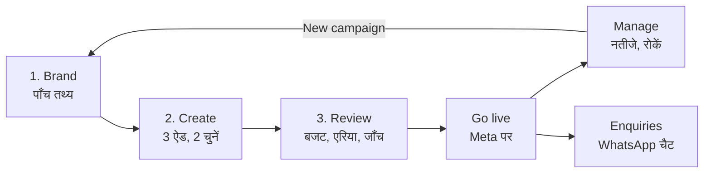

# AdBrain कैसे काम करता है
<!-- mirrors ../how-adbrain-works.md b971100b382b -->

यह [How AdBrain Works](../how-adbrain-works.md) का हिंदी रूप है; अंग्रेज़ी पेज बदले तो इसे भी बदलें।
[Features and workflows](../README.md) का हिस्सा। आसान शब्दों में एक पेज, पायलट ग्राहकों,
सेल्स कॉल और टीम में नए लोगों के लिए। हर कदम उसके पूरे पेज से जुड़ा है।

AdBrain छोटे बिज़नेस के लिए Facebook और Instagram ऐड बनाता है, उन्हें मालिक के अपने Meta
ऐड अकाउंट पर चलाता है, और पूछताछ (enquiries) को WhatsApp चैट के रूप में वापस लाता है।
पहला ऐड तीन कदम में बनता है; उसके बाद मालिक बस नतीजे देखता है और ग्राहकों को जवाब देता है।

## 1. Brand: AdBrain को अपने बिज़नेस के बारे में बताएँ

मालिक पाँच तथ्य भरता है: बिज़नेस का नाम, वह क्या बेचता है, किन जगहों पर सर्विस देता है, एक
ऑफ़र, और 10 अंकों का WhatsApp नंबर। **Fill it from my website** खाली फ़ील्ड भर देता है।
हर ऐड इन्हीं तथ्यों से लिखा जाता है, इसलिए AdBrain कभी अपनी तरफ़ से कोई ऑफ़र या फ़ोन नंबर
नहीं बनाता। पूरे Brand पेज पर बोलने का अंदाज़ (voice), ऑडियंस, रंग और लोगो भी जुड़ते हैं।
पूरी जानकारी: [Brand](brand.md)।

## 2. Create: ऐड बनाएँ

AdBrain कुछ छोटे सवाल पूछता है (मालिक जवाब में "Let the AI decide" चुन सकता है) और बिज़नेस
की भाषा में तीन ऐड बनाता है: अंग्रेज़ी, Hinglish, हिंदी या पंजाबी। इनमें से दो ऐड वह कैंपेन
के लिए पहले से चुन देता है। हर ऐड पर लिखा होता है कि उसमें **Your photo** है या **AI picture**।
Studio में मालिक ऐड का टेक्स्ट, फ़ोटो पर लिखे शब्द और बैकग्राउंड बदल सकता है।
पूरी जानकारी: [Create and review ads](create.md)।

## 3. Review करें और Go live करें

मालिक अपना Facebook Page और Meta ऐड अकाउंट जोड़ता है, रोज़ का बजट चुनता है (₹300, ₹500 या
₹1,000 रोज़) 2 दिन के लिए या, पायलट के लिए, 7 दिन के लिए, और देखता है कि ज़्यादा से ज़्यादा
कितना खर्च हो सकता है, Meta का GST मिलाकर। AdBrain एरिया, WhatsApp का स्वागत संदेश (welcome
message) और हफ़्ते की खर्च सीमा (spending cap) दिखाता है, फिर कुछ भी बनाने से पहले सब कुछ
जाँचता है। अगर कोई जाँच फ़ेल हो, तो वह बताता है कि क्या ठीक करना है और कुछ नहीं बनता। वरना
एक टैप में कैंपेन रुका हुआ (paused) बनता है और फिर चालू हो जाता है; अगर Meta मना कर दे, तो
कैंपेन रुका ही रहता है और कुछ खर्च नहीं होता। ऐड का पैसा मालिक के अपने ऐड अकाउंट से Meta को
जाता है। फिर Meta ऐड दिखना शुरू होने से पहले उन्हें जाँचता है।
पूरी जानकारी: [Connect Meta](setup.md), [Prepare a campaign](launch.md),
[Targeting and budget](targeting-and-budget.md), [Review and go live](review.md)।

## Manage: नतीजे देखें, रोकें, फिर से चलाएँ

Campaigns पेज और Home पर खर्च, चैट या पूछताछ, और हर एक की लागत दिखती है, साथ में यह भी कि
आँकड़े कितने ताज़ा हैं ("Updated 4m ago")। AdBrain इन्हें बैकग्राउंड में और पेज खुलने पर
रीफ़्रेश करता है। चलते हुए कैंपेन में कोई दिक्कत हो (Meta ने कोई ऐड रिजेक्ट किया, या 6 घंटे
बाद भी किसी ने ऐड नहीं देखा), तो उस पर वजह के साथ **Needs attention** दिखता है। जिस रन की
आख़िरी तारीख निकल गई, वह खत्म पढ़ा जाता है, और AdBrain उसे 15 मिनट के अंदर रोक देता है। मालिक कोई भी कैंपेन रोक (pause) सकता है, हफ़्ते की खर्च सीमा
लगा सकता है (auto-pause चालू हो तो हफ़्ते का खर्च उस सीमा तक पहुँचने पर AdBrain ऐड रोक देता
है), और नतीजे WhatsApp पर शेयर कर सकता है। AdBrain खुद किन चार वजहों से कैंपेन रोकता है, यह
[AdBrain ने आपका कैंपेन क्यों रोका](manage.md#adbrain-ने-आपका-कैंपेन-क्यों-रोका) में है। जिस हफ़्ते मालिक ने 5 या ज़्यादा पूछताछ दर्ज की
हों, उसके बाद Home उनके WhatsApp Status के लिए एक नतीजों वाला कार्ड देता है: बिज़नेस, उनके
एरिया में कितने लोगों ने पूछताछ की, उनका सबसे अच्छा ऐड और उनका WhatsApp नंबर, पैसे की बात
कभी नहीं। **New campaign** वही तीन कदम फिर से चलाता है, और सिर्फ़ वही पूछता है जो बदला है।
पूरी जानकारी: [Manage](manage.md), [Settings](settings.md)।

## Enquiries: ग्राहकों को जवाब दें

जो लोग ऐड पर टैप करते हैं, उनकी बिज़नेस के साथ WhatsApp चैट खुलती है। Home पर सबसे नई वह
पूछताछ दिखती है जिसका जवाब अभी बाकी है। Leads पेज पर हर कैंपेन की चैट और फ़ॉर्म वाली पूछताछ
की लिस्ट होती है, और **Add enquiry** से किसी और तरीके से आई असली पूछताछ दर्ज की जाती है,
ताकि नतीजों में वह भी गिनी जाए। पूरी जानकारी: [Manage: sync, results and leads](manage.md)।

## कौन क्या करता है

| कौन | क्या करता है |
| --- | --- |
| मालिक (Owner) | तथ्य देता है, ऐड चुनता है, बजट तय करता है, ग्राहकों को जवाब देता है |
| AdBrain | ऐड लिखता और बनाता है, कैंपेन जाँचता है, उसे बनाता और उस पर नज़र रखता है, auto-pause चालू हो तो सीमा पर ऐड रोक देता है |
| Meta | ऐड जाँचता और दिखाता है, ऐड का पैसा मालिक के ऐड अकाउंट से लेता है |

ऐप हिंदी में भी चलता है (Settings → App language): मेन्यू, ऐप बार और Home, जिसमें Recent
activity भी है, जो हर घटना का सिर्फ़ हिंदी लेबल दिखाता है, और हर कैंपेन का "How it's going"
वाला वाक्य और बटन, Home और Campaigns दोनों पर (#1438)। ऐड बनाने और कैंपेन सेव करने की मुख्य
गलतियाँ (AI सीमा पूरी, बहुत सारे अधूरे कैंपेन, सेव या जाँच जो नहीं हो पाई) भी हिंदी में आती हैं (#2305)।
विज्ञापन का बैकग्राउंड, शब्द या वर्ज़न बदलने, असिस्टेंट और Download की गलतियाँ भी हिंदी में आती हैं (#2324)।
