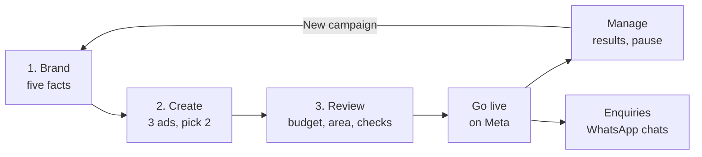

# How AdBrain Works

Part of [Features and workflows](README.md). One page, in plain words, for pilots,
sales calls and anyone new to the team. Each step links to its detailed page.

AdBrain makes Facebook and Instagram ads for a small business, runs them on the
owner's own Meta ad account, and brings the enquiries back as WhatsApp chats.
The first ad takes three steps; after that the owner watches results and replies
to customers.

## 1. Brand: tell AdBrain about the business

The owner fills in five facts: the business name, what they sell, the places they
serve, one offer, and a 10-digit WhatsApp number. **Fill it from my website** fills
the empty ones. These facts are what every ad is written from, so AdBrain never
invents an offer or a phone number. The full Brand page adds voice, audience,
colours and logo. Details: [Brand](brand.md).

## 2. Create: make the ads

AdBrain asks a few short questions (the owner can answer "Let the AI decide") and
makes three ads in the business's language: English, Hinglish, Hindi or Punjabi.
It pre-picks two of them for the campaign. Every ad says whether it
uses **Your photo** or an **AI picture**. In Studio the owner can edit the ad text,
the words on the picture and the background. Details: [Create and review ads](create.md).

## 3. Review and go live

The owner connects their Facebook Page and Meta ad account, chooses a daily
budget (₹300, ₹500 or ₹1,000 a day) for 2 days or, for pilots, 7 days, and sees the most it can spend,
Meta's GST included. AdBrain shows the areas, the WhatsApp welcome message and the
weekly spending cap, then checks everything before anything is created. If a check
fails, it says what to fix and nothing is created. Otherwise one tap creates the
campaign paused and then switches it on; if Meta refuses, the campaign stays paused
and nothing is spent. The ad money is paid to Meta from the owner's own ad
account. Meta then reviews the ads before they start showing.
Details: [Connect Meta](setup.md), [Prepare a campaign](launch.md),
[Targeting and budget](targeting-and-budget.md), [Review and go live](review.md).

## Manage: watch results, pause, run again

The Campaigns page and Home show spend, chats or enquiries and the cost of each,
with how fresh the numbers are ("Updated 4m ago"). AdBrain refreshes them in the
background and when the page opens. A running campaign with a problem (Meta
rejected an ad, no one has seen it after 6 hours, or its end date has passed)
shows **Needs attention** with the reason. The owner can pause any campaign, set
a weekly spending cap (with auto-pause on, AdBrain pauses the ads when the week's
spend reaches it), and share results on WhatsApp. After a week with 5 or more enquiries the
owner logged, Home offers a results card for their WhatsApp Status: the
business, how many people in their area enquired, their best ad and their
WhatsApp number, never money. **New campaign** runs the same three steps again,
asking only what changed. Details: [Manage](manage.md), [Settings](settings.md).

## Enquiries: reply to customers

People who tap the ad open a WhatsApp chat with the business. Home shows the newest
enquiry still waiting for a reply. The Leads page lists chats and form enquiries
per campaign, and **Add enquiry** logs a real enquiry that came in another way, so
results count it. Details: [Manage: sync, results and leads](manage.md).

## Who does what

| Who | Does |
| --- | --- |
| Owner | Gives the facts, picks the ads, sets the budget, replies to customers |
| AdBrain | Writes and draws the ads, checks the campaign, creates and watches it, pauses at the cap when auto-pause is on |
| Meta | Reviews and shows the ads, charges the ad money to the owner's ad account |

The app also works in Hindi (Settings → App language): the menu, app bar and
Home, including Recent activity, which shows only the Hindi label for each event,
and each campaign's "How it's going" sentence and buttons, on Home and Campaigns (#1438).
